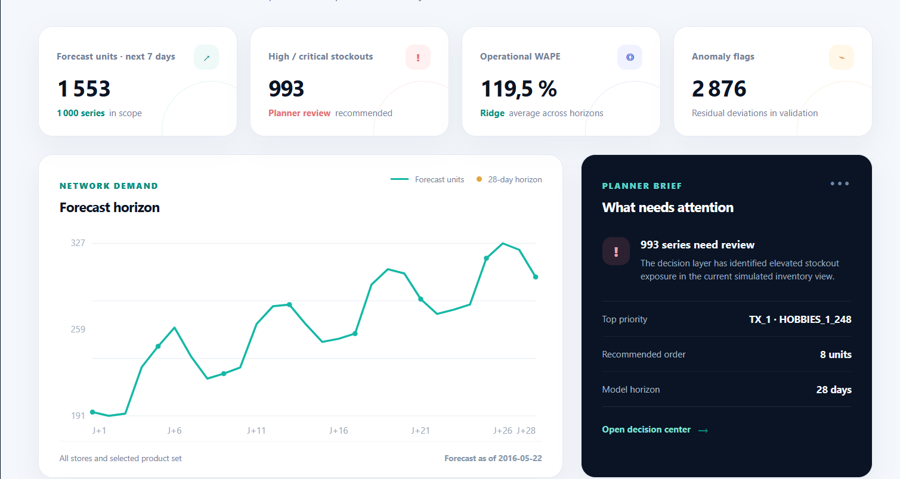
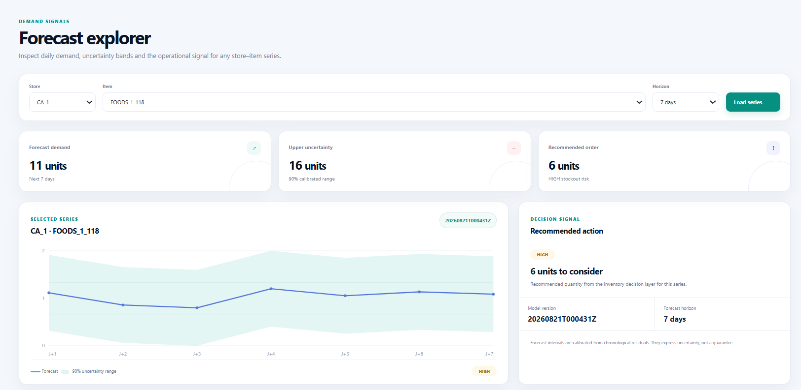
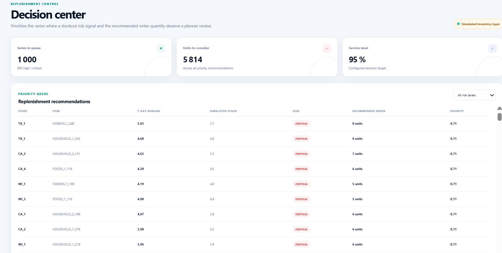
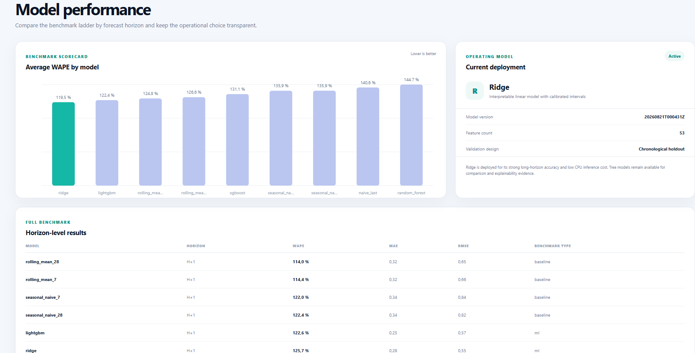
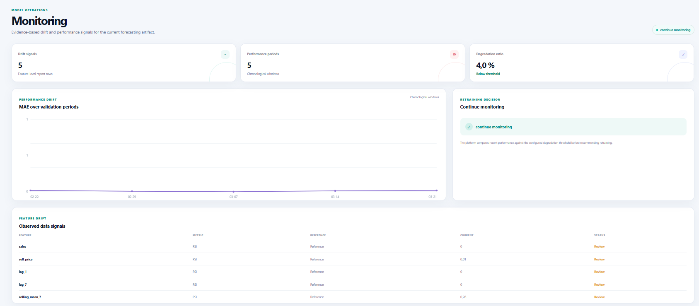

# Demand Forecasting & Decision Intelligence

An end-to-end retail forecasting project built on the public Walmart M5 dataset. It covers the full path from raw sales files to daily forecasts, uncertainty intervals, replenishment priorities, monitoring reports, and a small web application for planners.

The repository is intentionally written as a practical project rather than a notebook-only experiment. The data preparation, feature engineering, model training, evaluation, API, and interface can all be run locally.

## Contents

- [Project overview](#project-overview)
- [Application preview](#application-preview)
- [Dataset](#dataset)
- [Architecture](#architecture)
- [Repository layout](#repository-layout)
- [Installation](#installation)
- [Running the project](#running-the-project)
- [Pipeline](#pipeline)
- [Features and leakage control](#features-and-leakage-control)
- [Models and results](#models-and-results)
- [Uncertainty and anomaly detection](#uncertainty-and-anomaly-detection)
- [Replenishment decisions](#replenishment-decisions)
- [Web application](#web-application)
- [API reference](#api-reference)
- [Monitoring](#monitoring)
- [Screenshots to add](#screenshots-to-add)
- [Tests and code quality](#tests-and-code-quality)
- [Limitations](#limitations)

## Project overview

Retail teams need a reliable view of what each store and product may sell over the next few days. A useful forecasting system also needs to answer practical questions:

1. How much demand is expected?
2. How wide is the uncertainty around that estimate?
3. Which store-item pairs need attention first?
4. Which model and validation setup produced the number?
5. Has recent performance changed enough to justify a retraining review?

This project answers those questions for a representative subset of M5. It forecasts 1, 7, and 28 days ahead, compares simple baselines with machine-learning models, and turns the output into clearly labelled replenishment recommendations.

The inventory part is a demonstration layer. M5 contains sales, calendar, event, and price information, but it does not contain current stock or purchase orders. The application therefore uses a simulated stock value and shows that assumption wherever it matters.

## Application preview

The web application is served by FastAPI. It has five areas:

| Area | Purpose |
| --- | --- |
| Overview | Network-level demand, risk counts, and the highest-priority decisions |
| Forecast explorer | Daily forecast, uncertainty range, and one selected store-item series |
| Decision center | Replenishment recommendations sorted by priority |
| Model performance | Benchmark comparison by horizon and model |
| Monitoring | Feature drift, error trend, and retraining recommendation |

### Overview

The overview shows the main KPI cards, the aggregated forecast horizon, the planner brief, and the highest-priority decisions.

### Forecast explorer

This view focuses on one store-item series, its forecast curve, uncertainty range, and daily values.

### Decision center

The decision center ranks replenishment recommendations and makes the stockout-risk filter visible.

### Model performance

This screen compares WAPE across models and shows the Ridge artifact used by the application.

### Monitoring

The monitoring page contains the performance trend, drift rows, and the current retraining recommendation. Capture details are documented in docs/screenshots/README.md.

## Dataset

The source is the [M5 Forecasting - Accuracy dataset](https://www.kaggle.com/competitions/m5-forecasting-accuracy/data). A public archival reference is available on [Zenodo](https://doi.org/10.5281/zenodo.10203108).

The local run used in the reports contains:

| Quantity | Value |
| --- | ---: |
| Rows after reshaping | 1,913,000 |
| Store-item series | 1,000 |
| Items | 100 |
| Stores | 10 |
| States | 3 |
| Departments | 7 |
| Categories | 3 |
| Date range | 2011-01-29 to 2016-04-24 |
| Zero-sales rows | 93.3317% |
| Price coverage | 56.1506% |

The raw CSV files are deliberately excluded from Git because they are large. Place the following files in data/raw/:

~~~text
data/raw/sales_train_validation.csv
data/raw/calendar.csv
data/raw/sell_prices.csv
~~~

Or run:

~~~powershell
./.venv/Scripts/python.exe scripts/download_data.py
~~~

The downloader records source information and file hashes in results/reports/data_acquisition.json.

## Architecture

The following diagram shows the main processing path.

~~~mermaid
flowchart TD
    A[Raw M5 CSV files] --> B[Download and schema checks]
    B --> C[Subset selection]
    C --> D[Long-format parquet]
    D --> E[Validation and data profile]
    E --> F[Calendar, price, lag and rolling features]
    F --> G[Baseline forecasts]
    F --> H[Ridge, Random Forest, XGBoost and LightGBM]
    G --> I[Chronological backtest]
    H --> I
    I --> J[Metrics and model selection]
    I --> K[Residual intervals and error analysis]
    K --> L[Anomaly flags]
    J --> M[Operational Ridge artifact]
    M --> N[Forecast file]
    N --> O[Replenishment rules]
    L --> O
    N --> P[FastAPI and web application]
    O --> P
    I --> Q[Drift and performance reports]
    Q --> P
~~~

The request flow for the web application is deliberately simple:

~~~mermaid
sequenceDiagram
    participant Planner
    participant Browser
    participant API as FastAPI
    participant Store as Artifact store

    Planner->>Browser: Open the planning workspace
    Browser->>API: GET /overview, /catalog, /decisions
    API->>Store: Read CSV and JSON artifacts
    Store-->>API: Forecasts, risks and monitoring values
    API-->>Browser: JSON responses
    Browser-->>Planner: KPI cards, charts and tables
    Planner->>Browser: Select a store and item
    Browser->>API: GET /forecast/{store_id}/{item_id}
    API-->>Browser: Point forecast, interval and order quantity
~~~

Forecasts become decisions through the following rule chain:

~~~mermaid
flowchart LR
    A[Recent demand history] --> B[Feature matrix]
    B --> C[Forecast model]
    C --> D[Point forecast]
    C --> E[Residual-based interval]
    D --> F[Demand over lead time]
    E --> F
    F --> G[Safety stock and reorder point]
    G --> H[Stockout and overstock risk]
    H --> I[Recommended order quantity]
~~~

## Repository layout

~~~text
.
├── configs/                  YAML configuration files
├── data/
│   ├── raw/                  Local M5 CSV files; ignored by Git
│   ├── interim/              Sampling metadata
│   └── processed/            Parquet data and features; ignored by Git
├── docs/
│   ├── screenshots/          Images to include in the README
│   ├── CV_PROJECT_SUMMARY.md Short project summary
│   ├── EXPERIMENT_REPORT.md  Experiment notes and measured results
│   └── INTERVIEW_GUIDE.md    Technical discussion points
├── frontend/
│   ├── index.html            Application structure
│   ├── styles.css            Layout and visual styles
│   └── app.js                API calls, tables and canvas charts
├── notebooks/                Lightweight project notebooks
├── results/                  Local reports, metrics and model artifacts
├── scripts/                  Ordered pipeline entry points
├── src/demand_intelligence/  Python package and FastAPI application
├── tests/                    Unit tests on small synthetic data
├── Dockerfile
├── docker-compose.yml
├── pyproject.toml
└── requirements.txt
~~~

## Installation

Python 3.11 or newer is recommended.

### Windows PowerShell

~~~powershell
python -m venv .venv
./.venv/Scripts/python.exe -m pip install --upgrade pip
./.venv/Scripts/python.exe -m pip install -e ".[dev,ml,tracking]"
~~~

If python is not available on your machine, use the Python executable installed with your environment to create the virtual environment. Once .venv exists, all commands in this README can use ./.venv/Scripts/python.exe directly.

## Running the project

The current workspace already contains the processed data, trained artifact, forecasts, decisions, and monitoring reports. To open the application, only the API needs to be started:

~~~powershell
cd "C:/path/to/Demand Forecasting & Decision Intelligence"
./.venv/Scripts/python.exe -m uvicorn --app-dir src demand_intelligence.api.main:app --reload --port 8000
~~~

Open:

- Web application: <http://127.0.0.1:8000>
- API documentation: <http://127.0.0.1:8000/docs>
- Health check: <http://127.0.0.1:8000/health>

The application and API use the same process. There is no second dashboard service to start.

### Docker Compose

~~~powershell
docker compose up --build
~~~

Then open <http://127.0.0.1:8000>.

## Pipeline

Run the following commands only when the raw files or derived artifacts need to be rebuilt:

~~~powershell
./.venv/Scripts/python.exe scripts/download_data.py
./.venv/Scripts/python.exe scripts/prepare_data.py
./.venv/Scripts/python.exe scripts/build_features.py
./.venv/Scripts/python.exe scripts/train_baselines.py
./.venv/Scripts/python.exe scripts/run_backtest.py --models ridge,random_forest,xgboost,lightgbm
./.venv/Scripts/python.exe scripts/combine_benchmarks.py
./.venv/Scripts/python.exe scripts/train_models.py --model ridge
./.venv/Scripts/python.exe scripts/generate_forecasts.py
./.venv/Scripts/python.exe scripts/generate_decisions.py
./.venv/Scripts/python.exe scripts/generate_anomalies.py
./.venv/Scripts/python.exe scripts/run_error_analysis.py
./.venv/Scripts/python.exe scripts/run_monitoring.py
./.venv/Scripts/python.exe scripts/log_mlflow.py
~~~

The default subset is sized for a normal laptop. To change the sample, edit configs/data.yaml before running prepare_data.py.

## Features and leakage control

The feature pipeline combines:

- calendar fields, weekday, month, year and cyclical encodings;
- event and SNAP indicators;
- lags at 1, 7, 14, 28 and 56 days;
- shifted rolling means and standard deviations;
- exponentially weighted averages;
- price level and price movement;
- store, item, department, category and state identifiers.

The important rule is that every feature must be available at the forecast origin. Lags are created with shift(lag), rolling statistics are shifted before aggregation, and future targets are built separately from the feature frame. The test suite includes checks for these invariants.

Validation is chronological. There is no random train/test split because a random split would mix future observations into the training sample.

## Models and results

The benchmark includes simple baselines and four machine-learning models. WAPE is reported here because it is easy to interpret at portfolio level; the complete metric table also contains MAE, RMSE, MAPE, sMAPE and RMSSE where the training scale is available.

### WAPE on the local holdout

The following values come from the 1,000-series subset, a chronological 28-day holdout, and a 100,000-row training cap.

| Model | 1 day | 7 days | 28 days |
| --- | ---: | ---: | ---: |
| Rolling mean 28 | 1.140021 | 1.307565 | 1.296967 |
| Seasonal naive 7 | 1.220217 | 1.423103 | 1.432396 |
| Ridge | 1.256954 | 1.238200 | **1.089612** |
| LightGBM | 1.226120 | **1.222643** | 1.224408 |
| XGBoost | 1.302845 | 1.315182 | 1.314153 |
| Random Forest | 1.493239 | 1.406919 | 1.441578 |

Ridge is the operational model for this local run. It gives the best 28-day result and is inexpensive to retrain and serve on CPU. LightGBM remains useful for comparison and feature-attribution analysis. The choice is a trade-off, not a claim that one model wins for every horizon.

The main outputs are:

~~~text
results/metrics/model_benchmark.csv
results/metrics/model_benchmark.json
results/reports/model_selection.md
results/forecasts/model.joblib
results/forecasts/latest_forecasts.csv
~~~

## Uncertainty and anomaly detection

For each horizon, an absolute residual radius is estimated from chronological validation predictions. The radius is added to and subtracted from the point forecast to form lower and upper bounds. Coverage and interval width are reported separately; a wider interval is not automatically a better interval.

Anomalies are flagged from residual behaviour and interval breaches. In the local validation run, 2,876 of 28,000 rows were flagged, mostly as unexpected demand spikes. These are operational alerts for unusual forecast errors. They are not fraud findings and should be reviewed alongside business context.

Explainability files are written to:

~~~text
results/explainability/shap_global_importance.csv
results/explainability/shap_summary.png
results/explainability/shap_local_example.csv
~~~

SHAP describes how the fitted model uses its input features. It does not establish that a price, event, or promotion caused the observed demand.

## Replenishment decisions

The decision layer uses:

1. the forecast over the configured lead time;
2. the uncertainty interval as a safety-stock signal;
3. a simulated current-stock value derived from recent demand;
4. the configured service level and decision weights.

It returns a reorder point, stockout risk, overstock risk, recommended order quantity, and priority score. The inventory_source field is intentionally labelled so that a simulated value is not mistaken for a live inventory feed.

The resulting file is:

~~~text
results/decisions/decisions.csv
~~~

## Web application

The interface is a small static front end served by FastAPI. It does not require a JavaScript build step or a separate dashboard runtime.

### Main screens

| Screen | Main information |
| --- | --- |
| Overview | Forecast curve, forecast volume, risk mix, and the action queue |
| Forecast explorer | Store-item selector, point forecast, uncertainty range, and daily table |
| Decision center | Filterable replenishment recommendations |
| Model performance | WAPE comparison and current model metadata |
| Monitoring | MAE over time, data-drift rows, and retraining status |

The front end calls these routes on the same origin:

~~~text
GET /health
GET /overview
GET /catalog
GET /model/info
GET /forecast/{store_id}/{item_id}?horizon=7
GET /decisions
GET /anomalies
GET /metrics
GET /monitoring
~~~

## API reference

### GET /health

Returns the service state and whether the forecast and model artifacts are available.

### GET /forecast/{store_id}/{item_id}?horizon=7

Returns the selected series, point forecasts, lower and upper bounds, model version, stockout risk, and recommended order quantity. The horizon can be between 1 and 28 days.

Example:

~~~text
GET /forecast/CA_1/FOODS_1_118?horizon=7
~~~

### GET /decisions

Returns the decision table used by the Decision center.

### GET /metrics

Returns the model benchmark rows, including the horizon and benchmark type.

The interactive Swagger page at <http://127.0.0.1:8000/docs> contains the request and response schemas.

## Monitoring

The monitoring scripts keep data drift and forecast performance separate:

~~~mermaid
flowchart LR
    A[Recent feature window] --> B[PSI and KS checks]
    C[Recent validation errors] --> D[MAE trend]
    B --> E[Drift report]
    D --> F[Performance report]
    E --> G{Performance degradation above threshold?}
    F --> G
    G -->|No| H[Continue monitoring]
    G -->|Yes| I[Review retraining]
~~~

The current local report contains five drift rows and five performance periods. The degradation ratio is 0.0396 against a configured threshold of 0.20, so the recorded action is continue monitoring.

Files:

~~~text
results/reports/drift_report.csv
results/reports/performance_drift.csv
results/reports/monitoring_summary.json
~~~

## Screenshots to add

Create the folder docs/screenshots/ and use the following names. These files are not required to run the application; they are documentation assets for the README and project presentation.

| File | Capture | Recommended framing |
| --- | --- | --- |
| 01-overview.png | Overview page | Full browser width with KPI row and forecast chart |
| 02-forecast-explorer.png | One selected store-item series | Include the selector, chart, and daily forecast table |
| 03-decision-center.png | Priority queue | Filter to Critical or High risk |
| 04-model-performance.png | Benchmark page | Include the WAPE chart and current model card |
| 05-monitoring.png | Monitoring page | Include MAE trend and retraining status |
| 06-api-docs.png | Swagger page | Open /docs and expand one forecast endpoint |

For a consistent set of captures:

1. Start the application on port 8000.
2. Use a browser window at approximately 1440 × 900 pixels.
3. Keep the browser zoom at 100%.
4. Capture only the application area, without personal folders or terminals.
5. Save the files under docs/screenshots/ using the names above.

The detailed capture checklist is in docs/screenshots/README.md.

## Tests and code quality

Run the lightweight checks from the repository root:

~~~powershell
./.venv/Scripts/python.exe -m pytest
./.venv/Scripts/ruff.exe check src scripts tests
./.venv/Scripts/python.exe -m compileall -q src scripts
~~~

The tests use small synthetic frames so that they stay fast and do not depend on the M5 download. Training and data preparation are intentionally outside the test suite.

## Limitations

- The default run uses a representative subset rather than the full M5 matrix.
- M5 has no live stock, purchase-order, or lead-time feed; the inventory layer is simulated.
- Price and event fields are predictive inputs, not causal estimates.
- Intermittent and zero-heavy series remain difficult to forecast.
- The interval calibration is a useful baseline, not a guarantee of conditional coverage for every series.
- The local API has no authentication or user management.

A production version would connect live inventory and lead-time data, add approval workflows, store monitoring history, support hierarchical reconciliation, and promote models through a versioned registry.

## Data and project notes

- Dataset: [M5 Forecasting - Accuracy](https://www.kaggle.com/competitions/m5-forecasting-accuracy/data)
- Archival reference: [Zenodo 10203108](https://doi.org/10.5281/zenodo.10203108)
- Experiment notes: docs/EXPERIMENT_REPORT.md
- Interview notes: docs/INTERVIEW_GUIDE.md
- CV summary: docs/CV_PROJECT_SUMMARY.md

## License

See LICENSE.

## Author
Bouizdouzene Bilal